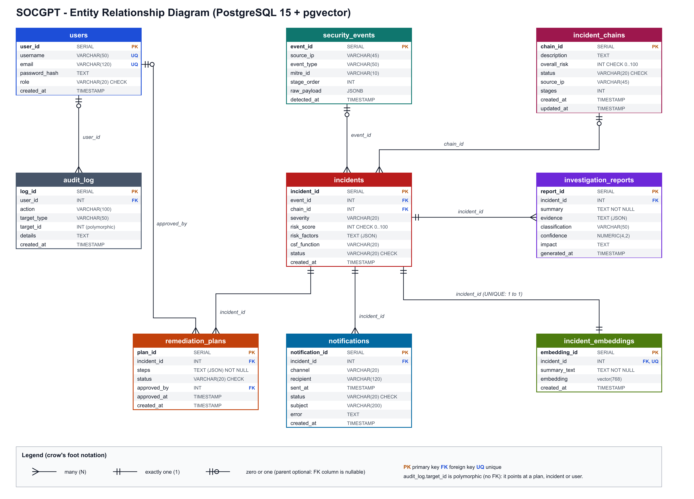

# 🛡️ SOCGPT: Autonomous Security Operations Center Simulator & Incident Response Platform

[](https://openjdk.org/)
[](https://spring.io/projects/spring-boot)
[](https://python.org)
[](https://fastapi.tiangolo.com)
[](https://langchain-ai.github.io/langgraph/)
[](https://ai.google.dev/)
[](https://www.postgresql.org/)
[](https://github.com/pgvector/pgvector)
[](https://www.docker.com/)
[](LICENSE)

> **SOCGPT** is an enterprise-grade Security Operations Center (SOC) simulation, automated investigation, and governance platform. It ingests high-velocity security telemetry, detects intrusions in real time via configurable sliding-window rules, computes context-aware dynamic risk scores, correlates related attacks into multi-stage kill chains, and leverages Google Gemini orchestrated with LangGraph for root-cause analysis and remediation planning.
>
> **Human-in-the-Loop by Design**: The AI acts as an advisor, never an unchecked actor. Remediation plans strictly enforce a **Four-Eyes Principle** with role-based access control (RBAC), immutable audit logging, on-demand byte-level PDF generation, and automated SMTP notifications.

---

## 📑 Table of Contents

- [Executive Summary & Motivation](#-executive-summary--motivation)
- [System Architecture](#-system-architecture)
- [Core Capabilities & Features](#-core-capabilities--features)
- [Cybersecurity Framework Alignments](#-cybersecurity-framework-alignments)
  - [MITRE ATT&CK Matrix](#mitre-attck-matrix)
  - [NIST CSF 2.0 Mapping](#nist-csf-20-mapping)
- [Database Architecture & ER Design](#-database-architecture--er-design)
- [Role-Based Access Control (RBAC)](#-role-based-access-control-rbac)
- [Project Directory Structure](#-project-directory-structure)
- [Getting Started & Quickstart](#-getting-started--quickstart)
  - [Prerequisites](#prerequisites)
  - [Method 1: Full Stack (Docker + Spring Boot + Python LangGraph)](#method-1-full-stack-docker--spring-boot--python-langgraph)
  - [Method 2: Standalone DevHarness (Zero Docker / Offline Mode)](#method-2-standalone-devharness-zero-docker--offline-mode)
- [Attack Simulator & Testing](#-attack-simulator--testing)
- [REST API Reference](#-rest-api-reference)
- [Testing & Validation](#-testing--validation)
- [Security & Production Hardening](#-security--production-hardening)
- [Engineering Concepts & Architecture](#-engineering-concepts--architecture)

---

## 💡 Executive Summary & Motivation

Modern Security Operations Centers drown in alert noise. Tier-1 and Tier-2 analysts spend hours on repetitive triage:
1. *Is this alert real or a false positive?*
2. *Is this part of an isolated scan or a coordinated multi-stage intrusion?*
3. *What is the blast radius, and what concrete steps must be taken to contain it?*

Granting an AI agent unconstrained autonomy to execute shell scripts or firewall rules in production is dangerous—an AI hallucination could sever core infrastructure. Conversely, purely manual triage results in catastrophic mean-time-to-respond (MTTR) latency.

**SOCGPT bridges this critical divide:**
- **AI-Accelerated Triage**: An autonomous agent investigates evidence, cross-references historical incidents via pgvector RAG, and generates a structured 5-stage response plan.
- **Strict Human-in-the-Loop Governance**: Every plan requires authenticated human approval. Critical-severity incidents strictly enforce a **Four-Eyes Principle** (SOC Manager approval required; Analysts cannot self-approve).
- **Full Traceability**: All approvals, rejections, manual executions, and report exports are written to an immutable audit ledger compliant with the **NIST Cybersecurity Framework (CSF 2.0) Govern** function.

---

## 🏛️ System Architecture

SOCGPT adopts an asynchronous, decoupled microservice architecture combining high-throughput Java enterprise services with Python AI agents.

```
                                  +---------------------------------------+
                                  |     Attack Simulator / REST Sensors   |
                                  +---------------------------------------+
                                                      |
                                          (X-Ingest-Key / HTTP POST)
                                                      v
+------------------------+        +---------------------------------------+
|  SOC Analyst & Manager |        |       Spring Boot Backend (Java 21)   |
|   Web UI (:8080)       |<======>| - Real-time Detection Engine          |
| - Glassmorphism UI     | (REST) | - Contextual Risk Scoring Matrix      |
| - Threat Gauge & Feeds |        | - Kill-Chain Multi-Stage Correlation  |
| - Attack Lab Controls  |        | - RBAC & Four-Eyes Approval Workflow  |
+------------------------+        | - Zero-Dependency PDF Engine          |
                                  +---------------------------------------+
                                           |                      |
                    (JDBC / pgvector :5433)|                      |(HTTP REST :8000)
                                           v                      v
                       +-------------------------+      +---------------------------+
                       | PostgreSQL 15+          |      | Python FastAPI Service    |
                       | - 9 Normalized Tables   |      | - LangGraph Workflow      |
                       | - pgvector Extension    |      | - Google Gemini 1.5 Flash |
                       | - 768-dim RAG Embeddings|      | - Evidence & Impact Eval  |
                       +-------------------------+      | - 5-Stage Remediation Gen |
                                   ^                    +---------------------------+
                                   |                                  |
                                   |==== (Vector Search / Cosine) ====┘
```

### Complete Incident Lifecycle Sequence

```mermaid
sequenceDiagram
    autonumber
    participant Sensor as Sensor / Simulator
    participant Java as Spring Boot Backend
    participant DB as Postgres + pgvector
    participant Agent as LangGraph AI Agent
    participant Gemini as Google Gemini
    participant Human as SOC Manager / Analyst
    participant Mail as Mailpit SMTP

    Sensor->>Java: POST /events (Attack Event + X-Ingest-Key)
    Java->>DB: Store SecurityEvent
    Java->>Java: DetectionService: Evaluate Sliding Window & Thresholds
    Java->>Java: RiskScoringService: Compute Base + Context Multipliers
    Java->>Java: ChainService: Check 30-min Kill-Chain Progression
    Java->>DB: Save Incident (status: OPEN)
    
    rect rgb(20, 35, 60)
        Note over Java,Gemini: Asynchronous AI Investigation Pipeline
        Java->>DB: RagService: Query Cosine Similarity (Past Incidents + Decisions)
        Java->>Agent: POST /investigate (Incident + Chain + RAG Context)
        Agent->>Gemini: Invoke LangGraph (Investigation Prompt)
        Gemini-->>Agent: Evidence, Classification, Confidence, Impact
        Agent->>Gemini: Invoke LangGraph (Remediation Prompt)
        Gemini-->>Agent: 5-Stage Remediation Plan
        Agent-->>Java: Structured Investigation Report + Plan JSON
        Java->>DB: Store InvestigationReport & RemediationPlan (PENDING)
        Java->>DB: Update Incident (status: AWAITING_APPROVAL)
        Java->>Mail: Send "Action Required" Alert (+ PDF Report)
    end

    Human->>Java: GET /api/incidents/{id} (Review AI Evidence & Plan)
    Human->>Java: POST /remediation-plans/{id}/approve (RBAC Checked)
    Java->>DB: Update Plan (APPROVED) & AuditLog Entry
    Human->>Java: POST /remediation-plans/{id}/execute
    Java->>Java: Run Simulated Recovery (Containment -> Prevention)
    Java->>DB: Update Incident (status: REMEDIATED) & AuditLog
```



---

## ⚡ Core Capabilities & Features

### 1. Real-Time Detection Engine
Evaluates incoming security telemetry against stateful rules using database sliding windows:
- **Instant Alerts**: `sqli` (SQL Injection) and `malware` trigger immediate CRITICAL incidents upon a single event (`burst: 1`).
- **Sliding-Window Aggregations**:
  - `brute_force`: Requires 3 failed attempts from the same source IP within a 5-minute sliding window.
  - `port_scan`: Requires 5 reconnaissance events from the same source IP within a 2-minute window.
- **Burst Deduplication**: Prevents alert storms; multiple identical triggers inside an active burst window update existing incident telemetry rather than spawning duplicate AI investigation costs.

### 2. Context-Aware Dynamic Risk Scoring Matrix
Rather than relying on static severity tags, `RiskScoringService` calculates a dynamic score ($0-100$) using rule baselines plus real-time contextual multipliers:
$$\text{Final Risk Score} = \min\left(100, \text{Baseline} + \sum \text{Context Factors}\right)$$

| Context Factor | Point Weight | Constraint / Condition |
|---|---|---|
| **Baseline Severity** | $95$ (Malware), $90$ (SQLi), $70$ (Brute Force), $50$ (Port Scan) | Assigned by the triggered detection rule |
| **Repeat Offender** | $+5$ points per past incident | Maximum $+15$ points |
| **Attack Chain Progression** | $+8$ points per kill-chain stage | Maximum $+24$ points |
| **Off-Hours Activity** | $+5$ points | Detected outside 08:00–18:00 local time |
| **Burst Size Density** | $+2$ points per event above threshold | Maximum $+6$ points |

*Guaranteed Severity Escalation*: Contextual scoring can only upgrade severity (e.g., MEDIUM $\rightarrow$ HIGH $\rightarrow$ CRITICAL); it will never downgrade a detection rule's baseline.

### 3. Multi-Stage Attack Chain Correlation
`ChainService` identifies distributed campaigns by correlating events sharing the same attacker IP address across two or more distinct MITRE ATT&CK tactics within a 30-minute sliding window:
1. **Reconnaissance** (`port_scan`, MITRE T1595)
2. **Credential Access** (`brute_force`, MITRE T1110)
3. **Initial Access / Exploit** (`sqli`, MITRE T1190)
4. **Execution** (`malware`, MITRE T1204)

When an attacker progresses along the kill chain, the backend automatically groups incidents into an `IncidentChain`, updates cumulative risk, and passes the entire attack chronology to the AI agent.

### 4. LangGraph AI Investigation Pipeline
The Python microservice implements a LangGraph state machine powered by Google Gemini 1.5 Flash:
- **Structured Evidence Extraction**: Synthesizes HTTP payloads, network indicators, and timestamp telemetry into machine-verifiable evidence.
- **Confidence Scoring & Impact Modeling**: Evaluates potential data exfiltration risk, regulatory exposure, and operational disruption.
- **5-Stage NIST-Aligned Remediation Planning**: Generates precise operational instructions across:
  1. `Containment` (e.g., IP blocking, credential revoking, session termination)
  2. `Eradication` (e.g., process killing, exploit patch staging)
  3. `Recovery` (e.g., service restart, state verification)
  4. `Validation` (e.g., vulnerability re-scanning, hash checking)
  5. `Prevention` (e.g., WAF rule deployment, rate-limiting)

### 5. Semantic Memory with pgvector (RAG)
`RagService` stores 768-dimensional vector embeddings of investigated incidents in PostgreSQL:
- On new incidents, the system executes an exact cosine similarity query:
  $$\text{similarity} = 1 - (\text{embedding} \Leftrightarrow \text{query\_vector})$$
- Past incidents exceeding `socgpt.rag.min-similarity=0.5` are injected into Gemini's context window.
- **Decision Learning**: The AI learns from human history—if analysts previously rejected a remediation plan for being "too disruptive", the LLM adapts future recommendations accordingly.

### 6. Four-Eyes Principle & Governance
Security operations demand strict separation of duties:
- **Analyst Role**: Can investigate incidents, run attack simulations, trigger AI re-analysis, and approve plans for `LOW`, `MEDIUM`, and `HIGH` severity incidents.
- **Four-Eyes Rule for CRITICAL**: Analysts **cannot** approve `CRITICAL` incidents. A `soc_manager` or `admin` must independently review and sign off.
- **Simulated Execution**: Only managers and admins can trigger automated recovery execution.

### 7. Zero-Dependency PDF Engine (`SimplePdf`)
Rather than pulling in heavy third-party PDF dependencies (e.g., iText or PDFBox), SOCGPT features a custom, lightweight byte-level PDF generator:
- Directly writes raw PostScript/PDF operators (`BT`, `Tf`, `re`, `f`, `ET`) into streaming byte arrays.
- Implements AFM font metrics for precise text measurement, multi-line word wrapping, dynamic page budgets, colored alert pills, and headers/footers.
- Generates publication-ready incident reports on the fly with zero disk I/O.

### 8. SOC Command Center Dashboard
Served natively via Spring Boot static assets (`/index.html`, `/incidents.html`, `/audit.html`):
- **Glassmorphic Cyber Dark Theme**: Real-time polling with CSS animations and micro-interactions.
- **Live Threat Gauge & Event Stream**: Instant visual indicators of current perimeter threat posture.
- **Telemetry Charts**: Hourly incident histograms, severity donuts, MITRE ATT&CK tactic frequencies, and NIST CSF 2.0 distributions.
- **Interactive Attack Lab**: One-click attack generators allowing analysts to simulate single bursts or multi-stage campaigns directly from the UI.

---

## 🎯 Cybersecurity Framework Alignments

### MITRE ATT&CK Matrix

| Technique ID | Technique Name | Tactic | Stage Order | Detection Mechanism |
|---|---|---|:---:|---|
| **T1595** | Active Scanning | Reconnaissance | 1 | $\ge 5$ port scan probes in 2 min |
| **T1110** | Brute Force | Credential Access | 2 | $\ge 3$ failed logins in 5 min |
| **T1190** | Exploit Public-Facing App | Initial Access | 3 | Immediate trigger (`sqli` payload) |
| **T1204** | User Execution | Execution | 4 | Immediate trigger (`malware` drop) |

### NIST CSF 2.0 Mapping

```
                                  +------------------------------------+
                                  |         NIST CSF 2.0 PILLARS       |
                                  +------------------------------------+
                                                    |
         +------------------+------------------+----+------------------+------------------+
         |                  |                  |                       |                  |
         v                  v                  v                       v                  v
     [GOVERN]          [IDENTIFY]          [PROTECT]                [DETECT]          [RESPOND & RECOVER]
  Immutable Audit   Asset Risk Scoring  Role-Based Access      Real-Time Rule     LangGraph 5-Stage Plan,
  Ledger & Policies  & Context Multiplier & Four-Eyes Rule     Sliding Windows    Four-Eyes Gate & Execution
```

- **Govern (GV)**: Complete audit trail (`audit_log` table) recording every login, approval, rejection reason, execution, and PDF export with CSV compliance reporting.
- **Identify (ID)**: Asset and attacker classification, IP threat history, and kill-chain stage ordering.
- **Protect (PR)**: Role-based access policies, PBKDF2 password hashing (120,000 rounds), and token authentication.
- **Detect (DE)**: Continuous telemetry evaluation against sliding-window threshold rules.
- **Respond (RS)**: AI-assisted investigation, automated containment generation, and email alerting with attached reports.
- **Recover (RC)**: Human-gated plan execution for rapid operational restoration.

---

## 🗄️ Database Architecture & ER Design

SOCGPT uses a fully normalised relational schema (PostgreSQL 15+) coupled with the `pgvector` extension for semantic AI memory.



### Schema Overview (9 Core Entities)

1. **`users`**: RBAC credentials, email identifiers, PBKDF2 hashes, and role definitions (`analyst`, `soc_manager`, `admin`).
2. **`security_events`**: High-velocity sensor log telemetry containing source IPs, event types, MITRE technique IDs, and JSON payloads.
3. **`incident_chains`**: Correlated multi-stage attack paths with cumulative risk and attack progression status (`ACTIVE`, `CONTAINED`, `RESOLVED`).
4. **`incidents`**: Central incident records containing severity, calculated risk score ($0-100$), serialized risk factors JSON, and NIST CSF category.
5. **`investigation_reports`**: LLM-generated forensic summaries, confidence ratings, attack classifications, and evidence JSON.
6. **`remediation_plans`**: 5-stage containment-to-prevention operational steps, approval timestamps, and approver references.
7. **`incident_embeddings`**: 768-dimensional vector embeddings with unique constraints for fast cosine distance semantic search.
8. **`audit_log`**: Append-only compliance log capturing user IDs, actions, target entities, and operation metadata.
9. **`notifications`**: SMTP alert tracking recording recipients, delivery status, and timestamps.

---

## 👥 Role-Based Access Control (RBAC)

| Account | Default Password | Role | Permissions & Authority |
|---|---|---|---|
| `admin` | `Admin@123` | `admin` | System superuser. User management, RAG vector re-indexing, full incident triage, approval, and execution. |
| `manager1` | `Manager@123` | `soc_manager` | Senior SOC Lead. Can review, approve, and execute remediation for **all** incidents (including **CRITICAL**). |
| `analyst1` | `Analyst@123` | `analyst` | SOC Operator. Can triage, launch attack simulations, re-trigger AI analysis, and approve **LOW / MEDIUM / HIGH** incidents. |

> [!IMPORTANT]
> **Four-Eyes Enforcement**: If an incident is graded **CRITICAL**, the backend actively blocks analysts from approving it (`HTTP 403 Forbidden: Critical incidents require a SOC manager`). A SOC Manager or Admin must review the investigation.

---

## 📂 Project Directory Structure

```
socgpt/
├── .gitignore                      # Comprehensive exclusions (.env, target/, venv/)
├── README.md                       # Master architecture & technical guide
├── docker-compose.yml              # Container orchestration (pgvector + Mailpit)
├── test-requests.http              # Ready-to-run REST Client API requests
├── .vscode/
│   └── settings.json               # IDE compiler & analysis configurations
├── agents-python/                  # Autonomous AI Microservice
│   ├── main.py                     # FastAPI server (/investigate, /embed, /health)
│   ├── graph.py                    # LangGraph StateGraph pipeline
│   ├── llm.py                      # Google Gemini Flash integration
│   ├── embeddings.py               # Vector generation (Gemini / sentence-transformers)
│   ├── prompts.py                  # Chain & investigation prompt templates
│   ├── test_agent.py               # Microservice unit & contract tests
│   ├── requirements.txt            # Python dependencies (fastapi, langgraph, etc.)
│   ├── .env.example                # Example environment template
│   └── .env                        # Local secrets (NEVER committed)
├── backend-java/                   # Core Enterprise Application
│   ├── pom.xml                     # Maven dependency descriptor (Spring Boot 3.2, Java 21)
│   ├── mvnw / mvnw.cmd             # Cross-platform Maven wrapper scripts
│   └── src/
│       ├── main/
│       │   ├── java/com/socgpt/backend/
│       │   │   ├── BackendApplication.java
│       │   │   ├── controller/      # REST API controllers (Auth, Dashboard, etc.)
│       │   │   ├── model/           # JPA entities (Incident, RemediationPlan, etc.)
│       │   │   ├── pdf/             # Byte-level PDF writer (SimplePdf, ReportPdfService)
│       │   │   ├── repository/      # Spring Data JPA repositories
│       │   │   ├── security/        # AuthInterceptor, PasswordService, RBAC policies
│       │   │   ├── service/         # Detection, RiskScoring, Chain, RAG, Metrics services
│       │   │   └── util/            # Custom JSON parsers and formatters
│       │   └── resources/
│       │       ├── application.properties # Main application configuration
│       │       └── static/          # Web UI assets (HTML, CSS, JavaScript)
│       └── test/                    # Full integration test suite (Embedded PG, Mocks)
├── db/
│   ├── schema.sql                  # Canonical PostgreSQL DDL (tables, indexes, pgvector)
│   └── migrate_v2.sql              # Idempotent database schema migration script
├── docs/
│   ├── ER_Diagram.png              # Entity-Relationship diagram
│   └── SOCGPT_Project_Report.docx  # Full comprehensive academic project report
├── frontend/
│   └── .gitkeep                    # Frontend tracker (static assets served by Java)
└── simulator/
    └── attack_simulator.py         # CLI attack generator (single, bursts, campaigns)
```

---

## 🚀 Getting Started & Quickstart

### Prerequisites
- **Operating System**: Windows, Linux, or macOS
- **Java Development Kit (JDK)**: Java 21 or newer
- **Python**: 3.10 or newer with `pip`
- **Docker & Docker Compose**: Installed and running
- **Google Gemini API Key**: Free tier key from [Google AI Studio](https://aistudio.google.com/)

---

### Method 1: Full Stack (Docker + Spring Boot + Python LangGraph)

#### Step 1: Clone the Repository
```bash
git clone https://github.com/Srinandhinip/SOCGPT-An-AI-powered-Security-Operations-Center-simulator-and-incident-response-platform.git
cd SOCGPT-An-AI-powered-Security-Operations-Center-simulator-and-incident-response-platform
```

#### Step 2: Launch Database & Mail Server Containers
From the project root:
```bash
docker compose up -d
```
*Verify containers*: Run `docker ps`. You should see `socgpt-db` (port 5433) and `socgpt-mail` (ports 1025, 8025) running.

#### Step 3: Start the Python AI Agent
In a new terminal:
```bash
cd agents-python

# Create and activate virtual environment
python -m venv venv
# On Windows PowerShell:
.\venv\Scripts\activate
# On Linux/macOS:
# source venv/bin/activate

# Install dependencies
python -m pip install -r requirements.txt

# Configure your Gemini API Key
copy .env.example .env    # On Linux/macOS: cp .env.example .env
# Edit .env and enter: GEMINI_API_KEY=your_gemini_api_key_here

# Start FastAPI server on port 8000
python -m uvicorn main:app --reload --port 8000
```
Wait until the terminal displays: `Application startup complete`.

#### Step 4: Start the Spring Boot Backend
In a separate terminal:
```bash
cd backend-java

# On Windows PowerShell:
.\mvnw.cmd spring-boot:run

# On Linux/macOS:
# ./mvnw spring-boot:run
```
Wait until the terminal displays: `Started BackendApplication in X seconds`.

#### Step 5: Access the Platform
- **SOC Command Center**: Open [http://localhost:8080](http://localhost:8080)
- **Sign In**: Username `manager1` | Password `Manager@123`
- **Mailpit Email Inbox**: Open [http://localhost:8025](http://localhost:8025) to view live alert dispatches and PDF attachments.

---

### Method 2: Standalone DevHarness (Zero Docker / Offline Mode)

Want to inspect or demo the application without Docker, Python, or external API keys? SOCGPT includes a built-in development harness with an in-memory database and stub AI agent:

```powershell
cd backend-java
.\mvnw.cmd -q test-compile dependency:build-classpath "-Dmdep.outputFile=target\cp.txt" "-Dmdep.includeScope=test"
java -cp "target\classes;target\test-classes;$((Get-Content target\cp.txt -Raw).Trim())" com.socgpt.backend.DevHarness
```
Open [http://localhost:8080](http://localhost:8080) to interact with the mock system.

---

## 🎯 Attack Simulator & Testing

The Python attack generator in `simulator/` mimics malicious network activity by posting directly to `/events` using sensor credentials (`X-Ingest-Key: dev-ingest-key`).

```bash
cd simulator

# 1. Multi-Stage Kill-Chain Campaign (Recon -> Brute Force -> SQL Injection from ONE IP)
python attack_simulator.py campaign

# 2. Random Single Attacks (5 attacks, 2 seconds apart)
python attack_simulator.py

# 3. Specific Attack Scenarios
python attack_simulator.py sqli           # Instant Critical Alert
python attack_simulator.py brute_force     # 3-event burst
python attack_simulator.py port_scan       # 5-event burst
python attack_simulator.py malware         # Immediate Critical Alert
```

---

## 📡 REST API Reference

All `/api/*` endpoints require authentication via `Authorization: Bearer <token>` except `/api/auth/login`.

| Method | Endpoint | Access Role | Description |
|---|---|---|---|
| `POST` | `/api/auth/login` | Public | Authenticates user; returns 8-hour stateless token. |
| `GET` | `/api/auth/me` | Authenticated | Returns current authenticated user profile and role. |
| `POST` | `/events` | Sensor / Admin | Ingests raw telemetry (`X-Ingest-Key` required). Triggers detection. |
| `GET` | `/api/stats` | Authenticated | Aggregates dashboard metrics, threat gauges, and MTTR times. |
| `GET` | `/api/incidents` | Authenticated | Lists all incidents with severity, risk scores, and statuses. |
| `GET` | `/api/incidents/{id}` | Authenticated | Full incident view: report, evidence, plan, chain, and permissions. |
| `GET` | `/api/incidents/{id}/report.pdf` | Authenticated | Generates and downloads on-demand PDF incident report. |
| `POST` | `/api/incidents/{id}/reinvestigate` | Analyst, Manager | Re-triggers AI investigation for OPEN incidents. |
| `GET` | `/api/chains` | Authenticated | Returns active and resolved multi-stage attack chains. |
| `POST` | `/remediation-plans/{id}/approve` | Analyst*, Manager | Approves remediation plan (*Analyst blocked on CRITICAL). |
| `POST` | `/remediation-plans/{id}/reject` | Analyst, Manager | Rejects remediation plan with mandatory query parameter `reason`. |
| `POST` | `/remediation-plans/{id}/execute` | Manager, Admin | Executes approved plan containment and recovery actions. |
| `POST` | `/api/simulate` | Analyst, Manager | Launches attack burst from specified or randomized IP. |
| `GET` | `/api/audit` | Authenticated | Returns top 500 immutable audit trail logs. |
| `POST` | `/api/rag/reindex` | Admin | Re-embeds all investigated incidents into PostgreSQL pgvector. |

---

## 🧪 Testing & Validation

### Backend Integration Test Suite
The backend contains a full end-to-end integration test suite using embedded PostgreSQL, mock email servers, and stubbed AI responses:

```powershell
cd backend-java
.\mvnw.cmd test
```

**Test Coverage Includes**:
- Role authentication, rate limiting, and 5-attempt brute-force account lockout.
- Real-time rule thresholds and sliding-window event deduplication.
- Four-Eyes policy enforcement (verifying analysts are rejected from approving CRITICAL incidents).
- Dynamic risk score escalation and kill-chain stage progression.
- End-to-end PDF generation (saved to `backend-java/target/it` for visual inspection).

---

## 🔒 Security & Production Hardening

When deploying SOCGPT in an enterprise environment:
1. **Secrets Management**: Replace `socgpt.auth.secret` and `socgpt.ingest.key` in `application.properties` with environment variables managed by Vault or AWS Secrets Manager.
2. **API Keys**: Ensure `agents-python/.env` is never checked into source control. Use container secret injection in production.
3. **Transport Security**: Deploy behind a TLS-terminating reverse proxy (e.g., NGINX, Cloudflare) with HTTPS enabled.
4. **Database Hardening**: Replace default credentials in `docker-compose.yml` (`socgpt_dev_password`) with high-entropy passwords. Set `socgpt.seed-demo-users=false` in production.

---

## 🎓 Engineering Concepts & Architecture

This project was developed combining core principles of **Database Management Systems (DBMS)** and **Advanced Programming (AP)**.

- **DBMS Concepts Applied**: Normalized 3NF schemas, foreign key constraints, composite and partial indexes, ACID transactional boundaries, vector cosine distance searches (`pgvector`), and idempotent schema migrations (`migrate_v2.sql`).
- **Advanced Programming Concepts Applied**: Java 21 features (Records, Pattern Matching, Stream API), concurrent thread pools, custom security annotations with runtime reflection, byte-level file generators, REST microservice architecture, and Python LangGraph state machines.

---

## 📄 License
This project is licensed under the MIT License - see the [LICENSE](LICENSE) file for details.
